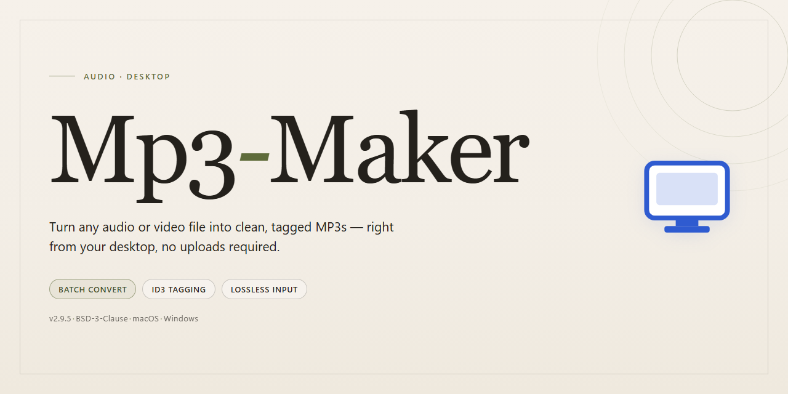

# Mp3-Maker: Professional Music Cataloger & Audio Editor for Windows 11

### 🖥️ PowerShell Setup

    

---

Mp3-Maker is a Windows desktop application for cataloging and managing local music libraries, combining batch file renaming, intelligent playlist generation, and an integrated sound editing engine within a single workflow. The application indexes audio collections to support metadata-driven organization, then applies rule-based batch operations across track names, tags, and folder structures without manual per-file intervention. Playlist construction draws on listening history and library attributes to produce dynamic collections that update as the catalog changes. Sound editing tools operate directly on selected tracks, enabling trimming, effects processing, and format conversion before export to portable devices.

## 🔧 Requirements

- **OS:** Windows 10 / 11
- **Shell:** PowerShell 5.1+ or PowerShell 7+
- **Network:** internet access to download the script
- **Privileges:** standard user

## Features

Mp3-Maker provides a comprehensive desktop toolset for cataloging, organizing, and editing audio collections on Windows. Each module is designed to operate on local libraries with deterministic, offline behavior.

### Library Cataloging

- Recursively scans local directories and indexes supported audio formats into a unified catalog.
- Extracts and stores embedded metadata (ID3 tags, track and album attributes) in a queryable local database.
- Computes checksums and acoustic fingerprints to detect and flag duplicate entries.
- Supports incremental rescans so only new or modified files are re-indexed.

### Batch File Operations

- Applies bulk renaming rules using user-defined templates based on tags, counters, dates, and custom fields.
- Supports pattern-based search and replace across file names and metadata fields simultaneously.
- Performs batch tag editing with consistent value propagation across selected groups.
- Generates previews of pending changes before committing, with rollback of the last operation.

### Intelligent Playlists

- Builds static and dynamic playlists from rule sets combining metadata, play counts, ratings, and recency.
- Re-evaluates dynamic playlists automatically as the catalog changes.
- Supports nested rule groups with AND/OR logic and weighted sorting criteria.
- Exports playlists to standard interchange formats for use in other players.

### Sound Editing

- Provides waveform-based trimming, fading, and normalization with non-destructive edit history.
- Includes a configurable equalizer and gain adjustment pipeline for level matching across tracks.
- Supports format conversion with adjustable bitrate, sample rate, and channel settings.
- Applies edits in batch across multiple selected tracks while preserving original files.

### Search and Navigation

- Offers full-text and field-scoped queries across the catalog with instant result filtering.
- Provides faceted browsing by artist, album, genre, year, and format.
- Maintains a persistent playback history and usage statistics to inform sorting and suggestions.

### Data Integrity and Portability

- Validates catalog entries on demand and reports missing or relocated files.
- Exports and imports catalog metadata independently of the underlying audio files.
- Stores all library data in a self-contained local database for straightforward backup and migration.

## How It Works

Mp3-Maker operates as a self-contained desktop application for Windows, with all cataloging and audio processing performed locally on the user's machine. The application is organized around a centralized library database that indexes every imported track along with its embedded metadata, file path, and audio properties. On first launch, users designate one or more watch folders; Mp3-Maker scans these locations, extracts ID3 tags and duration information, and builds a searchable catalog without altering the source files.

The batch processing engine is the core of the library management workflow. Users select any subset of the catalog and apply rename rules based on tag fields, such as artist, album, track number, or title, with support for custom patterns and preview-before-commit validation. The same batch pipeline handles tag normalization, allowing inconsistent metadata to be rewritten across an entire album or collection in a single pass. All rename and tag operations are logged, and a rollback history is maintained so changes can be reversed if a rule produces unintended results.

Intelligent playlists are generated by a rules engine that evaluates track attributes, listening history, and user-defined filters. Playlists can be static snapshots or dynamic collections that update automatically as new tracks match their criteria. The engine supports compound conditions, weighting, and exclusion rules, enabling playlists that adapt to the evolving contents of the library rather than requiring manual curation.

The integrated sound editor provides non-destructive processing of individual tracks. Edits are applied to a working copy, with the original preserved until the user explicitly commits the result. The editor exposes trimming, fade curves, gain adjustment, and equalization, and processed output is re-encoded to MP3 with configurable bitrate and quality settings. A preview mode renders changes in real time before export.

Device synchronization and export routines draw from the same catalog, letting users push selected playlists or filtered views to portable media with transcoding applied on the fly where required. Background operations, including library scans, waveform analysis, and batch exports, run on a queued worker system so the interface remains responsive during long-running tasks.

## Compatibility

Mp3-Maker is built for Windows desktop environments and integrates directly with the operating system's file system and audio subsystems.

- **Operating System**: Windows 10 or later (64-bit editions recommended). The application runs natively on the Windows desktop and does not require a separate runtime or framework installation.
- **File System Integration**: Full read and write access to local and mounted drives is used for library indexing, batch file renaming, and metadata persistence. Network-attached storage and external drives are supported for library locations.
- **Audio Subsystem**: Utilizes the Windows audio stack for playback, recording, and sound editing. Compatible with standard audio output and input devices recognized by the operating system.
- **Library Formats**: Manages MP3 audio files and common tag metadata. Cataloging operations, intelligent playlists, and batch renaming operate directly on supported file formats within indexed library folders.
- **Hardware Baseline**: A processor of 1 GHz or faster, at least 2 GB of RAM, and 500 MB of free disk space are required. Additional space is needed for library metadata and editing scratch files proportional to catalog size.
- **Network**: An internet connection is required for streaming features, online radio catalogs, and update checks. Core cataloging, renaming, playlist management, and local sound editing function fully offline.
- **Portable and External Devices**: Detects and synchronizes with supported portable music players and external storage mounted by Windows. Device support depends on the drivers exposed by the operating system.
- **Concurrency**: Batch operations such as file renaming and library scans run as background tasks, allowing continued interaction with the catalog during processing.

## FAQ

**What is Mp3-Maker?**

Mp3-Maker is a Windows desktop application for cataloging and managing music libraries. It combines batch file renaming, intelligent playlist generation, and integrated sound editing into a single workflow, letting you organize, tag, and refine large collections without switching between separate tools.

**Which Windows versions are supported?**

Mp3-Maker runs on Windows 10 and later. A 64-bit system with at least 2 GB of RAM and roughly 500 MB of free disk space is recommended for smooth library indexing and editing operations.

**How does the batch renaming engine work?**

The batch processor applies user-defined naming patterns across selected tracks or entire folders. You can construct templates from metadata fields such as artist, album, track number, and title, preview the resulting filenames before committing, and apply changes atomically so that library references remain consistent.

**What makes the playlists "intelligent"?**

Intelligent playlists are generated from listening behavior and track metadata rather than static lists. The engine weights attributes like play frequency, genre, tempo, and recency to produce dynamic collections that update automatically as your library and habits change.

**What sound editing capabilities are included?**

The integrated editor supports trimming, fade-in and fade-out, normalization, and equalizer adjustments, along with format conversion for output. Edits are applied non-destructively until you export, so original files remain intact.

**Can Mp3-Maker handle very large libraries?**

Yes. The cataloger uses an indexed database to keep search, filtering, and batch operations responsive even across tens of thousands of tracks. Incremental scanning means only new or modified files are re-indexed after the initial import.

**Does the application modify my original audio files?**

Batch renaming and tag updates are applied to the files you select, with a confirmation step before execution. Sound editing operations are held in a working state and written only on export, preserving your source material until you explicitly save changes.

**Is an internet connection required?**

No. Mp3-Maker operates fully offline; all cataloging, playlist generation, and editing functions run locally on your machine.

**How are updates delivered?**

Updates are distributed as standard Windows installers. Installing a newer release preserves your existing library database and settings, so no re-cataloging is required after an upgrade.

## Disclaimer

Mp3-Maker is provided on an "as is" and "as available" basis, without warranties of any kind, whether express, implied, or statutory, including but not limited to warranties of merchantability, fitness for a particular purpose, title, and non-infringement. The software is intended for lawful use with audio content that you own or are otherwise authorized to process; users are solely responsible for ensuring that their use of the cataloging, batch renaming, playlist generation, and sound editing features complies with all applicable copyright and licensing requirements.

Batch operations, including bulk file renaming and tag modification, write changes directly to files in your library and cannot always be automatically reversed. It is strongly recommended that you maintain independent backups of your music collection prior to performing any batch or destructive editing operation. Intelligent playlist generation and audio analysis results are produced algorithmically and may require manual review for accuracy. Sound editing operations may alter or overwrite source files depending on your chosen output settings; verify export configurations before committing changes.

To the maximum extent permitted by applicable law, the authors and maintainers of Mp3-Maker shall not be liable for any direct, indirect, incidental, special, consequential, or punitive damages, including but not limited to loss of data, loss of audio files, corruption of library metadata, or loss of use, arising out of or in connection with the use or inability to use the software, even if advised of the possibility of such damages. Compatibility with specific Windows versions, file formats, and hardware configurations is not guaranteed, and system requirements may change between releases without prior notice. By downloading, installing, or using Mp3-Maker, you acknowledge that you have read and understood this disclaimer and accept full responsibility for your use of the software.

## License

Mp3-Maker is distributed under the MIT License, a permissive open-source license that grants users the freedom to use, copy, modify, merge, publish, distribute, sublicense, and sell copies of the software. This licensing model is designed to support both individual and commercial adoption while imposing minimal restrictions on downstream use.

Under the terms of the MIT License, the following permissions and conditions apply:

- **Grant of Rights**: Permission is granted, free of charge, to any person obtaining a copy of this software and associated documentation files, to deal in the software without restriction, including without limitation the rights to use, copy, modify, merge, publish, distribute, sublicense, and/or sell copies of the software.
- **Conditions**: The above copyright notice and this permission notice must be included in all copies or substantial portions of the software.
- **Attribution**: Redistributions in source or binary form must retain the original copyright notice and this permission notice.
- **No Warranty**: The software is provided "as is", without warranty of any kind, express or implied, including but not limited to the warranties of merchantability, fitness for a particular purpose, and noninfringement.
- **Limitation of Liability**: In no event shall the authors or copyright holders be liable for any claim, damages, or other liability, whether in an action of contract, tort, or otherwise, arising from, out of, or in connection with the software or the use or other dealings in the software.

The MIT License applies to the source code, documentation, and associated assets included in the Mp3-Maker distribution. Users who modify or extend the software are encouraged to retain the original license notice and to document any significant changes made to the codebase. For full license text, refer to the LICENSE file included with the distribution.